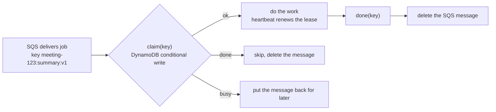

# DynamoDB as the idempotency store for SQS workers: a proof of concept

Background job workers read from Amazon SQS. SQS delivers every message **at least once**, so the same
job can reach a worker twice: after a slow job outlives its visibility timeout, after a worker is killed
mid-job, or when the producer sends twice. If the job writes to a CRM, sends an email or calls a paid AI
API, running it twice is a real problem.

This POC shows how to make every job safe to run twice with a **claim store**, and proves that
**DynamoDB** can be that store with **no application code change** once a small interface is in place.

## The short answers

| Question | Answer | Details |
|---|---|---|
| Our workers have no idempotency store. Do we need an app change to add DynamoDB? | **Yes, once.** Only the worker knows when the real work happened, so it must claim the job before working and mark it done after. No infrastructure setting can do that. | [docs/01](docs/01-do-we-need-a-code-change.md) |
| Our workers use Redis. What do we change to use DynamoDB? | **With the claim-store interface: configuration only** (`CLAIM_STORE=dynamodb`, a table, IAM). Without it, every Redis call in the worker must be rewritten. | [docs/01](docs/01-do-we-need-a-code-change.md), [docs/04](docs/04-switching-from-redis.md) |
| We already use SQS. Why do we need this at all? | SQS knows only "handed out" and "deleted". It does not know whether the work already happened. SQS FIFO deduplicates sends within 5 minutes, not processing. | [docs/02](docs/02-why-sqs-still-needs-it.md) |
| How does DynamoDB store the keys and stop duplicates? | One item per job key, changed only by **conditional writes**, with a lease that expires if a worker dies. | [docs/03](docs/03-how-dynamodb-stores-the-keys.md) |
| Does it work? | 8 of 8 correctness tests pass for both backends. In an SQS demo with 50 jobs, about 100 deliveries and 6 workers, every job's side effect ran exactly once. In a full incident simulation, 0 duplicates. | [docs/05](docs/05-tests-and-results.md) |

## How it works in one picture



## Repository layout

```
src/claimstore.py           the interface + RedisStore + DynamoStore (the only backend-specific code)
src/worker_example.py       a minimal SQS worker showing exactly where the claim store is called
tests/claim_poc.py          8 correctness tests, run against either backend
tests/claim_trace.py        narrated run printing the DynamoDB item after every step
tests/sqs_duplicate_demo.py end-to-end: duplicates through a real SQS API, side effects counted
docker-compose.yml          run everything locally (Redis, DynamoDB Local, ElasticMQ)
kustomization.yaml, k8s/    run everything in Kubernetes
results/                    output of the runs described in docs/05
docs/                       the explanations
```

## Run it

Locally with Docker:

```sh
docker compose up -d redis dynamodb sqs
docker compose run --rm tests     # 8 tests, Redis then DynamoDB
docker compose run --rm trace     # step-by-step: what the DynamoDB table holds
docker compose run --rm demo      # duplicates through SQS, Redis then DynamoDB
docker compose down
```

In Kubernetes (creates the namespace `claim-poc`):

```sh
kubectl apply -k .
kubectl -n claim-poc logs -f job/claim-tests
kubectl -n claim-poc logs -f job/claim-trace
kubectl -n claim-poc logs -f job/sqs-duplicate-demo
kubectl delete -k .
```

Switching backend anywhere is one variable: `CLAIM_STORE=redis` or `CLAIM_STORE=dynamodb`.

## Documents

1. [Do we need a code change?](docs/01-do-we-need-a-code-change.md)
2. [Why SQS still needs a claim store](docs/02-why-sqs-still-needs-it.md)
3. [How DynamoDB stores the keys](docs/03-how-dynamodb-stores-the-keys.md)
4. [Switching a live system from Redis to DynamoDB](docs/04-switching-from-redis.md)
5. [Tests and results](docs/05-tests-and-results.md)
6. [Running it on AWS](docs/06-running-on-aws.md)

## Limits

DynamoDB Local and ElasticMQ are emulators. They behave like DynamoDB and SQS for these operations, but they
do not reproduce real latency, throttling or TTL timing. Load-test the real table before production.
