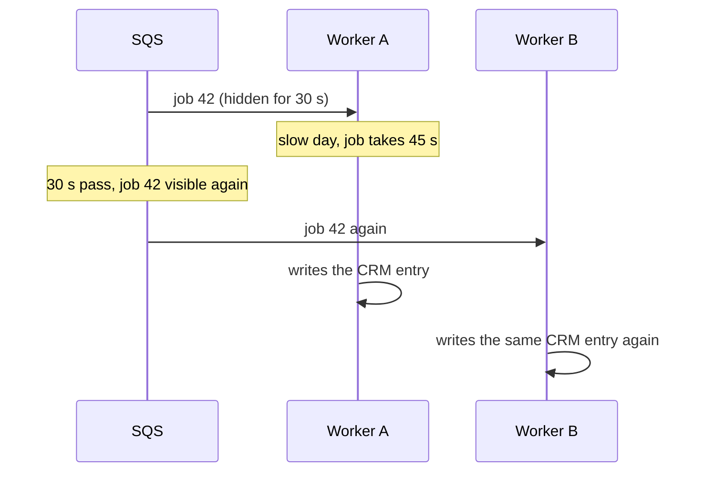

# 2. Why SQS still needs a claim store

SQS and the claim store do different jobs:

- **SQS moves the work.** It hands a message to a worker and hides it for the visibility timeout.
- **The claim store remembers what is done.** It records "job 42 is DONE" so a repeat can be skipped.

SQS knows only two facts about a message: it was handed out, and later it was (or was not) deleted. It does
not know whether the worker's side effects already happened.

## Three ways the same job reaches a worker twice

| Cause | What happens |
|---|---|
| **Slow job** | The job outlives the visibility timeout; SQS gives it to a second worker while the first is still working. |
| **Killed worker** | The worker did the work but died before `DeleteMessage`. After the timeout, SQS hands the job out again. |
| **Producer retry** | The application sent the same job twice (two different message IDs, same business key). |

## Why SQS FIFO does not fix it

SQS FIFO has "exactly-once processing", but its deduplication covers **sends** within a 5-minute window.
It stops the producer creating a second copy of a message. It does **not** stop a message being delivered
again after its visibility timeout expires, which is exactly the slow-job and killed-worker cases. FIFO also
has lower throughput, and one stuck message blocks the rest of its message group.

## So the design is

| Layer | Job |
|---|---|
| SQS Standard | Deliver work at least once, at any scale |
| Claim store (DynamoDB) | First guard: a repeat sees DONE or "busy" and does nothing |
| `UNIQUE(job_key)` in the database | Second guard: a second insert fails |
| `Idempotency-Key` header on outside calls | Second guard: the provider returns its earlier answer instead of charging again |

The claim store is the guard that stops the work from starting at all, so it also saves compute and paid
API calls. The second guards catch anything that slips through, for example while switching backends.
