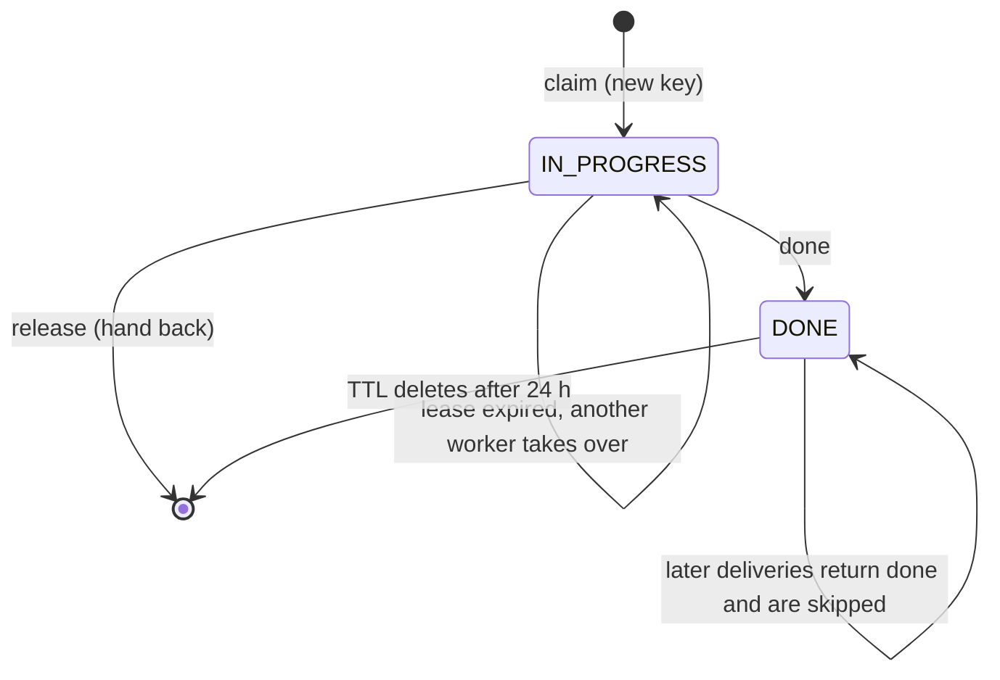

# 3. How DynamoDB stores the keys

## The table

One table, partition key `pk` (string), on-demand billing. Two kinds of item live in it.

**Job claims**, one item per job key:

| Attribute | Example | Meaning |
|---|---|---|
| `pk` | `claim#meeting-101:summary:v1` | The job's own key, set by the producer |
| `status` | `IN_PROGRESS` or `DONE` | Is someone working on it, or is it finished |
| `owner` | `worker-A` | Which worker holds it (the pod name in production) |
| `lease_expires` | `1791711072` | Epoch seconds; after this, a dead owner's claim can be taken over |
| `ttl` | now + 24 h | DynamoDB deletes the item automatically after a day |

**API slots**, `apislot#0` to `apislot#15`: each concurrent call to a rate-limited outside API holds one
slot (`owner`, `lease_expires`). Sixteen slots means at most sixteen calls at once across all workers.

## The rule that makes it safe: conditional writes

Every write says "do this **only if** a condition holds", and DynamoDB checks the condition and writes in one
atomic step. When two workers try at the same moment, exactly one condition passes. No locks and no
transactions are needed.

| Operation | DynamoDB call | Condition |
|---|---|---|
| `claim(key)` | `PutItem` status=IN_PROGRESS, owner=me, lease=now+L | `attribute_not_exists(pk)` OR (`status = IN_PROGRESS` AND `lease_expires < now`) |
| If the claim fails | `GetItem` (strongly consistent) | DONE means return `"done"`, otherwise `"busy"` |
| `extend(key)` | `UpdateItem` SET lease_expires=now+L | `owner = me` AND `status = IN_PROGRESS` |
| `done(key)` | `PutItem` status=DONE, ttl=now+24h | none |
| `release(key)` | `DeleteItem` | `owner = me` AND `status = IN_PROGRESS` |
| `api_acquire()` | `PutItem` on a random free `apislot#n` | `attribute_not_exists(pk)` OR `lease_expires < now` |
| `api_release(t)` | `DeleteItem` the slot | `owner = token` |

The ownership conditions matter. A worker whose lease already expired, and was taken over, cannot extend or
delete the new owner's claim.

## The life of one key



## Watching it happen

[`tests/claim_trace.py`](../tests/claim_trace.py) runs the real `DynamoStore` code and prints the item after
every step. Full output: [`results/trace-kubernetes.txt`](../results/trace-kubernetes.txt). The lease is 4 s
for the demo.

**1. A normal job.** No item exists. Worker A claims it; the heartbeat moves the lease forward; finishing
turns the item to DONE.

```
claims it  -> ok     {"owner": "worker-A", "status": "IN_PROGRESS", "lease_expires": "... (in +3 s)"}
heartbeat            {"owner": "worker-A", "status": "IN_PROGRESS", "lease_expires": "... (in +4 s)"}
marks DONE           {"owner": "worker-A", "status": "DONE"}
```

**2. Delivered again after it finished.** Worker B gets `done`, skips it and deletes the message. The item
does not change. Nothing runs twice.

**3. Two workers at once** (the job outlived the SQS visibility timeout). Worker A holds it; worker B gets
`busy` and puts the message back. When B retries after A finished, it gets `done`.

**4. A worker killed mid-job.**

```
worker-A claims  -> ok       {"owner": "worker-A", "status": "IN_PROGRESS", "lease_expires": "... (in +3 s)"}
worker-A is killed: no heartbeat, no DONE, no release
worker-B at once -> busy     (lease still valid)
5 s later                    {"owner": "worker-A", "status": "IN_PROGRESS", "lease_expires": "... (in -2 s)"}
worker-B again   -> ok       {"owner": "worker-B", "status": "IN_PROGRESS", ...}      <- takes over
worker-A wakes up late and tries to release: refused, item still worker-B's
worker-C         -> busy
worker-B marks DONE          {"owner": "worker-B", "status": "DONE"}
```

**5. Hand-back on shutdown.** Worker A gets SIGTERM, cannot finish in time, deletes its claim and sets the
SQS visibility to 0. Worker B claims the job immediately.

**6. API slots.** Three concurrent calls hold three slot items, for example `apislot#6`, `apislot#7`,
`apislot#15`. After release, none are left.

## How it fits with SQS in the worker

1. SQS hands out the message.
2. `claim(key)` decides whether this worker may do the job.
3. While working, a heartbeat thread renews both the SQS visibility timeout and the claim lease.
4. `done(key)`, then `DeleteMessage`.

The order matters. If the worker dies after `done` but before `DeleteMessage`, the redelivery sees DONE and
is skipped: no harm. If it dies before `done`, the lease expires and another worker redoes the job, which
is why outside calls also carry an `Idempotency-Key`.

## Choosing the lease length

The lease should be longer than the gap between heartbeats, with a safety margin. The worker example uses
lease = 3 × the SQS visibility timeout and beats every visibility ÷ 3, so several heartbeats can be missed
before anyone takes over. A shorter lease means faster takeover after a crash; a longer one is more
tolerant of slow networks.
